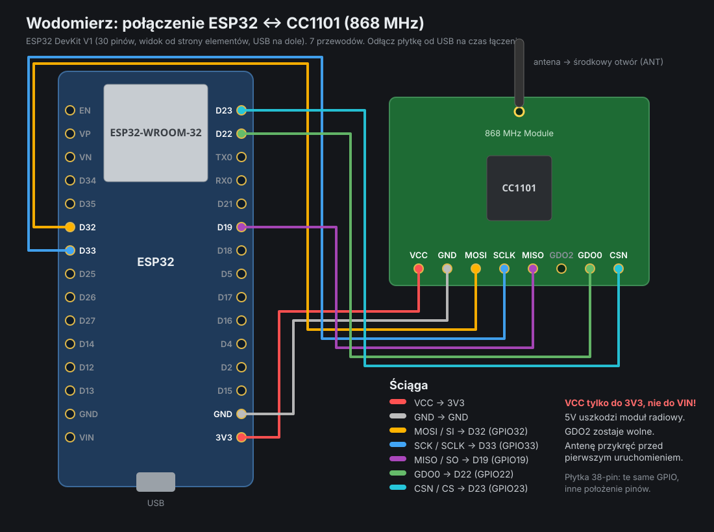

# Wodomierz – odczyt nakładki IZAR przez ESP32 + CC1101

Odczyt zużycia wody z wodomierza z radiową nakładką **Diehl IZAR RC 868** (popularna u polskich wodociągów)
do **Home Assistant**, bez ingerencji w licznik. ESP32 z modułem **CC1101 868 MHz** nasłuchuje ramek
Wireless M-Bus (tryb T1, 868,95 MHz), które nakładka i tak nadaje co kilka sekund dla inkasenta.

*Reading a Diehl IZAR RC 868 water meter (wM-Bus T1) with ESP32 + CC1101 in ESPHome / Home Assistant.*



## Co dostajesz w Home Assistant

| Encja | Opis |
|---|---|
| Stan licznika | m³, rozdzielczość 1 litr, nowa wartość co ~8 s – gotowe do panelu Energia → Woda |
| Stan na koniec miesiąca | stan z ostatniego dnia poprzedniego miesiąca (zapisany w nakładce) |
| Alarmy / Poprzednie alarmy | np. wyciek, zdjęcie nakładki, przepływ wsteczny |
| Bateria nakładki | szacowany pozostały czas pracy (lata) |
| Sygnał licznika, Wi-Fi, Czas pracy | diagnostyka |

## Części

- ESP32 DevKit V1 (ESP32-WROOM-32, 30 pinów; wersja 38-pin też pasuje – te same GPIO, inne położenie pinów)
- Moduł CC1101 **868 MHz** (z anteną – wersja 433 MHz nie zadziała)
- 7 przewodów, zasilacz USB 5 V

## Połączenia

| CC1101 | ESP32 |
|---|---|
| VCC | 3V3 (**nie VIN / 5 V!**) |
| GND | GND |
| MOSI / SI | GPIO32 |
| SCK / SCLK | GPIO33 |
| MISO / SO | GPIO19 |
| CSN / CS | GPIO23 |
| GDO0 | GPIO22 |
| GDO2 | niepodłączone |

Antenę przykręć przed pierwszym uruchomieniem. Źródło schematu: [`schemat.html`](schemat.html) (otwórz w przeglądarce).

## Uruchomienie

```bash
python3 -m venv .venv && .venv/bin/pip install esphome
cp secrets.example.yaml secrets.yaml   # uzupełnij Wi-Fi i hasła
.venv/bin/esphome run wodomierz.yaml   # pierwszy raz przez USB, potem OTA
```

Po starcie Home Assistant sam wykryje urządzenie (integracja ESPHome) – podaj klucz `api_key`.

## Jak znaleźć ID radiowe nakładki

**ID w ramce radiowej to nie jest numer z naklejki.** Najprościej:

1. Wgraj firmware z `meter_id: "0x00000000"`.
2. W logach (`esphome logs wodomierz.yaml`) pojawią się linie `ramka RSSI=… dane=…` od wszystkich nakładek w zasięgu,
   także sąsiadów.
3. Ramka IZAR zaczyna się od `…44 30 4c` + 4 bajty ID w kolejności **odwrotnej** (little-endian):
   `1944304c 78563412 …` → ID `0x12345678`.
4. Twoja to ta, której ramki zmieniają się, gdy odkręcisz kran (albo z najsilniejszym RSSI).
   Wpisz ID do `meter_id` i wgraj ponownie.

Gdy wszystko działa, blok `on_frame` z logowaniem każdej ramki można usunąć.

## Własne dodatki bez zmiany tego pliku

Zamiast edytować `wodomierz.yaml`, możesz go dołączyć jako pakiet i nadpisać ID:

```yaml
substitutions:
  meter_id: "0x12345678"
packages:
  base: !include wodomierz.yaml
```

## Uwagi

- Komponenty wM-Bus: [SzczepanLeon/esphome-components](https://github.com/SzczepanLeon/esphome-components)
  (`wmbus_radio`, `wmbus_meter`, dekodery z wmbusmeters).
- Nakładka nadaje tylko stan bieżący i stan z końca poprzedniego miesiąca – historii wstecz z niej nie odczytasz.
- Zasięg z garażu przez ścianę: ~-70…-80 dBm wystarcza.
- Odbierasz tylko to, co nakładka i tak wysyła publicznie; nie zmieniasz niczego w liczniku.

## Licencja

MIT
